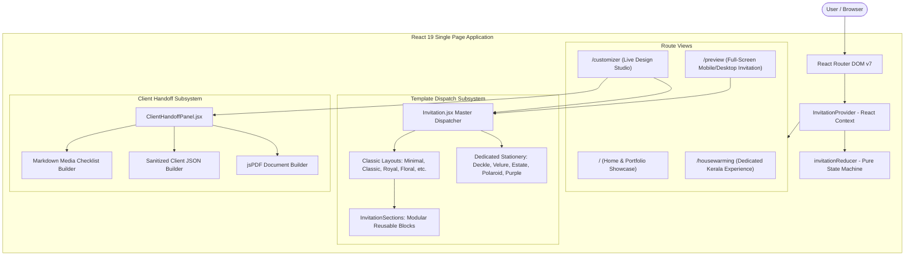
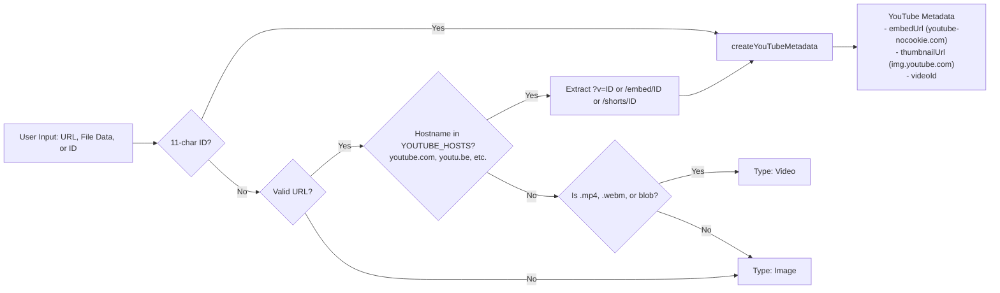
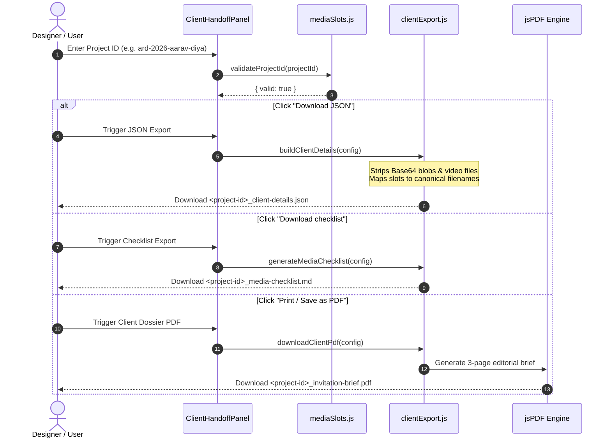

# Ardhas Invitations — AI System Architecture & Data Dictionary

> **Audience:** AI Coding Assistants, System Architects, Full-Stack Engineers.  
> **Repository:** `ardhas-invitations`  
> **Document Purpose:** Complete architectural diagrams, state machine specifications, data dictionaries, and component dependency graphs.

---

## 1. System Architecture Overview

Ardhas Invitations is a client-side Single Page Application (SPA) designed with a zero-backend philosophy. It functions simultaneously as a client-facing interactive invitation portfolio and as an internal production design studio for the Ardhas service workflow.



---

## 2. State Machine & Draft Isolation

### Draft State Architecture
To prevent data loss while exploring different themes or celebrations, each of the 16 celebration types maintains its own isolated draft state in memory.

```mermaid
stateDiagram-v2
    [*] --> InitialState: App Load

    state InitialState {
        activeEvent: "Wedding"
        drafts: { Wedding: getEventDefaults("Wedding") }
    }

    InitialState --> SwitchOccasion: action.type = "event"
    SwitchOccasion --> PreservedDraft: Draft exists for eventType
    SwitchOccasion --> NewDraftCreated: Draft does not exist -> getEventDefaults(eventType)

    state PreservedDraft {
        activeEvent: newEventType
        drafts: retains prior edits
    }

    PreservedDraft --> ApplyTemplate: action.type = "template"
    ApplyTemplate --> TemplateUpdated: updates style, layout, color, font, bg

    TemplateUpdated --> UpdateDraft: action.type = "update"
    UpdateDraft --> DraftModified: shallow merge patch into active draft

    DraftModified --> ResetDraft: action.type = "reset"
    ResetDraft --> DefaultRestored: restores getEventDefaults(activeEvent)
```

### Action Dispatch Contracts

```typescript
type InvitationAction =
  | { type: "event"; eventType: OccasionType }
  | { type: "template"; id: string }
  | { type: "update"; patch: Partial<InvitationConfig> }
  | { type: "reset" };
```

---

## 3. Template Dispatch & Rendering Pipeline

`src/templates/Invitation.jsx` is the single source of truth for invitation rendering.

```mermaid
flowchart TD
    Config[Invitation Config State] --> Keys[Extract currentKey: config.style || config.template]
    Keys --> CheckDedicated{Is Dedicated Stationery?<br/>deckle, velure, polaroid,<br/>estate, purple, lavender}
    
    CheckDedicated -->|Yes| RenderStationery[Render Dedicated Template Component<br/>e.g. DeckleRomance / MinimalismPurple]
    CheckDedicated -->|No| RenderClassic[Render Classic Template Component<br/>e.g. MinimalLuxury / ClassicTraditional]
    
    RenderClassic --> RenderSections[Render Shared InvitationSections.jsx<br/>Hero, Couple, Schedule, Venue, RSVP, etc.]
    RenderStationery --> SkipSections[Skip InvitationSections<br/>Sections are built directly into stationery]
    
    RenderSections --> OrderSheet[Render ArdhasOrderSheet<br/>Production specification notes]
    SkipSections --> OrderSheet
    
    OrderSheet --> FinalView[Render Full Invitation Article<br/>with CSS Variables: --invite-accent, --invite-font]
```

### Dynamic Contrast Engine
The dispatcher automatically calculates the perceptual luminance of the accent color using ITU-R BT.709 coefficients:

$$\text{Luminance} = 0.2126 \times R_{\text{linear}} + 0.7152 \times G_{\text{linear}} + 0.0722 \times B_{\text{linear}}$$

If $\text{Luminance} > 0.179$, `--invite-on-accent` is set to `#000000`; otherwise, it is set to `#ffffff`, guaranteeing WCAG 2.1 AA text contrast on buttons and badges.

---

## 4. Universal Media Engine (`src/utils/media.js`)

All media inputs across Ardhas support images, local uploads, and YouTube videos.



---

## 5. Client Handoff & Production Export Architecture



---

## 6. Comprehensive Data Dictionary

### Core Invitation Configuration (`InvitationConfig`)

| Field | Type | Description |
| :--- | :--- | :--- |
| `projectId` | `string` | Unique client ID matching `^[a-z0-9-]{3,40}$`. Required for production export. |
| `eventType` | `string` | One of the 16 supported celebration types (e.g., `"Wedding"`, `"Housewarming"`). |
| `template` | `string` | Unique template identifier (e.g., `"wedding-1"`, `"housewarming-3"`). |
| `style` | `string` | Aesthetic style token (`"deckle"`, `"velure"`, `"estate"`, `"polaroid"`, `"purple"`, `"classic"`, `"royal"`, etc.). |
| `layout` | `string` | Spatial layout mode (`"deckle"`, `"velure"`, `"estate"`, `"polaroid"`, `"purple"`, `"editorial"`, `"split"`, `"arch"`, `"framed"`, `"floating"`). |
| `color` | `string` | Hex color code (e.g., `"#8d7045"`). |
| `font` | `string` | Font family selection (`"Serif"`, `"Minimal"`, `"Modern"`, `"Royal"`, `"Handwritten"`). |
| `background` | `string` | Page background texture (`"Plain"`, `"Ivory Paper"`, `"Linen"`, `"Gold Foil"`, `"Custom Image"`). |
| `names` | `string` | Primary headline names (e.g., `"Aarav & Diya"`). |
| `date` | `string` | Celebration date in `YYYY-MM-DD` format. |
| `time` | `string` | Ceremony start time in `HH:mm` format. |
| `venue` | `string` | Short venue / city name. |
| `address` | `string` | Full venue address for navigation. |
| `heroImage` | `string` | Main photograph URL or uploaded image data. |
| `heroVideoUrl`| `string` | Optional looping hero background video URL. |
| `videoUrl` | `string` | Celebration film link (accepts any YouTube URL or MP4). |
| `wedding` | `object` | Detailed Indian wedding names (Groom/Bride full names, parents' names, family repeater). |
| `events` | `array` | Multi-event itinerary repeater (e.g., Haldi, Mehendi, Sangeet, Muhurtham, Reception). |
| `customFields`| `array` | Dynamic custom fields with format `^[a-z][a-z0-9_]*$` (`lower_snake`). |
| `sections` | `object` | Boolean feature flags toggling visibility of sections (`story`, `schedule`, `gallery`, `video`, `rsvp`, etc.). |
| `copy` | `object` | Editorial copy labels, button captions, and section titles. |

---

## 7. Media Slot Registry (`src/data/mediaSlots.js`)

All media assets required by a template are dynamically computed by `getMediaSlots(config)`:

| Slot ID | Slot Label | Required | Recommended Aspect Ratio | Config Key |
| :--- | :--- | :--- | :--- | :--- |
| `HERO_IMAGE` | Welcome / Hero Photograph | **Yes** | 16:9 or 3:2 landscape (min 1400x900px) | `config.heroImage` |
| `HERO_VIDEO` | Welcome Background Video | No | 16:9 landscape MP4/WebM | `config.heroVideoUrl` |
| `BACKGROUND_IMAGE` | Custom Background Texture | No | 16:9 or seamless vertical pattern | `config.image` |
| `VIDEO_POSTER` | Video Cover Poster | No | 16:9 landscape (min 1200x675px) | `config.videoPoster` |
| `WEDDING_VIDEO` | Celebration Video | No | 16:9 landscape (YouTube / MP4) | `config.videoUrl` |
| `GALLERY_IMAGE_01` | Gallery Photograph 1 | No | 3:2 or 4:3 (min 1200x800px) | `config.gallery[0].src` |
| `GALLERY_IMAGE_02` | Gallery Photograph 2 | No | 3:2 or 4:3 (min 1200x800px) | `config.gallery[1].src` |
| `GALLERY_IMAGE_03` | Gallery Photograph 3 | No | 3:2 or 4:3 (min 1200x800px) | `config.gallery[2].src` |

---

## 8. Directory & Component Dependency Map

```
App.jsx (Router, Hash Scroll Restoration)
├── Home.jsx (Showcase, Collection Grid, Booking CTA)
│   ├── Navbar.jsx
│   ├── FilterBar.jsx
│   └── BookingDialog.jsx
├── Customizer.jsx (Studio Split Pane)
│   ├── ClientHandoffPanel.jsx (PDF, JSON, Checklist, ZIP)
│   └── Invitation.jsx (Live Embedded Preview)
├── Preview.jsx (Full Screen Invitation)
│   ├── EnvelopeOpening.jsx
│   ├── TemplateSwitcherDock.jsx
│   └── Invitation.jsx
└── Housewarming.jsx (Dedicated Kerala Experience)
    ├── BlurText.jsx
    ├── CelebrationMark.jsx
    └── HousewarmingGames.jsx (3x3 Puzzle, Lamp, Decor)
```
